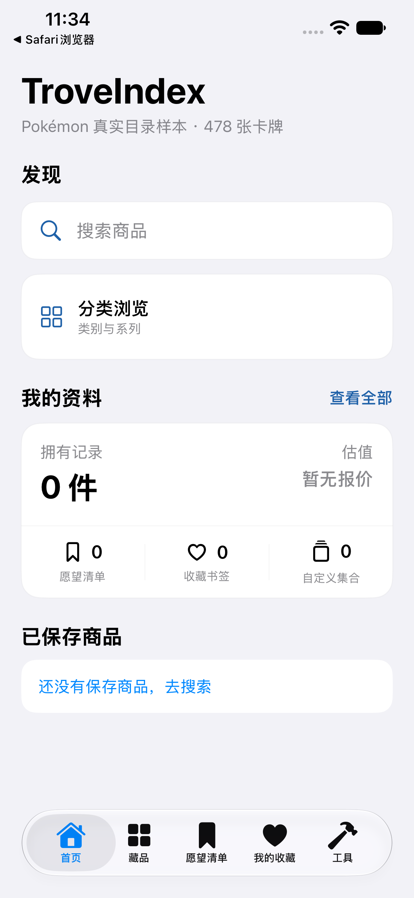
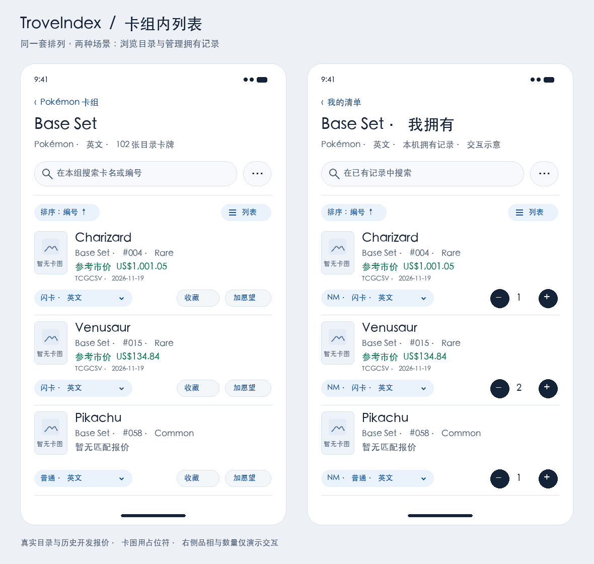

# TroveIndex · iOS 收藏管理

TroveIndex 是一款 iPhone 收藏管理应用，覆盖集换式卡牌、体育卡、电子游戏、游戏手办、钱币和邮票。用户可以按分类浏览、搜索藏品、查看详情，并用收藏、愿望清单或拥有记录管理自己的藏品。

## iOS 前端 · Swift / SwiftUI

- **分类与搜索**：六大分类采用双列封面网格，每类有独立封面和目录样本数量。进入 Pokémon 卡组后可按卡名或编号定位卡牌。目录、搜索、详情、书签和愿望清单共用同一个卡牌 ID。开发版内置目录可离线浏览，也可通过同一仓库接口读取 Java API。
- **界面语言**：可在应用内切换英语、墨西哥西班牙语、加拿大法语、简体中文、繁体中文和日语。界面语言与卡牌原始语言分别管理。
- **详情与价格**：展示卡组、编号、语言、稀有度与卡牌版本；已匹配的报价按版本展示来源和观测日期。只有一个观测日时显示参考报价，无需用一条趋势线推测变化。
- **个人收藏**：书签、愿望清单和拥有记录各有用途；还支持自建藏品、个人集合与批次记录。私人更改可先在本机排队，登录后与后端同步。

## Java 后端 · Spring Boot / PostgreSQL

- **目录服务与数据管理**：提供卡组、卡牌查询及版本和价格快照接口。管理员可导入完整卡组、预览 CSV 建档变化，并对来源和发布状态做审核。Flyway 管理数据库版本。
- **可重放导入**：每批卡组在一个事务内写入。来源外部键映射到稳定的内部 ID；重复提交不会新增重复条目。有冲突的 ID 或同日报价会进入复核流程，避免覆盖既有数据。
- **账号与同步**：实现邮箱账号、会话管理和个人数据隔离。书签、愿望清单、拥有记录、自建藏品、集合和批次记录均有独立的持久化或同步路径；部分写操作支持幂等重试和版本冲突处理。

## 真实数据接入

开发版的六类目录都有数据样本。以 Pokémon 为例，已接入 **478 张真实卡牌、1,041 个卡牌版本**。TCGdex 提供基础目录，CardCorpus 用于核对版本，TCGCSV 提供可匹配的历史报价快照。导入时校对卡组、卡牌编号及产品版本，保留来源和观测日期。该批次中，329 张卡关联了 484 条匹配的价格快照。

| 卡组 | 语言 | 卡牌数 |
| --- | --- | ---: |
| Destined Rivals | 英文 | 244 |
| Base Set | 英文 | 102 |
| Battle Partners | 日文 | 132 |

## 界面展示

| Pokémon 目录接入时的首页（模拟器实拍） | Base Set 列表与拥有记录（交互设计稿） |
| --- | --- |
|  |  |

六大分类的新封面（应用内资源）：

| 集换式卡牌 | 体育卡 | 电子游戏 |
| --- | --- | --- |
|  |  |  |

| 游戏手办 | 钱币 | 邮票 |
| --- | --- | --- |
|  |  |  |

## 工程节选

[查看 Swift 目录搜索与 Java 报价入库代码](CODE-EXCERPTS.md)。目录和报价数据的来源分别为 TCGdex、CardCorpus 和 TCGCSV；作品集展示产品与工程实现，不分发原始数据包或卡牌原画。
